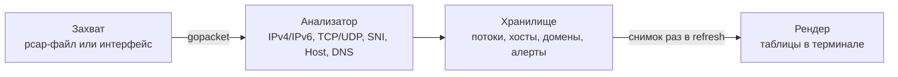

# netwatch

Анализатор сетевого трафика на Go: захват pcap и live, агрегация потоков, TLS SNI и DNS-имена, простые алерты.

## Что это

netwatch читает пакеты через gopacket — из pcap-файла или прямо с сетевого интерфейса — и раскладывает их по потокам, хостам, доменам, протоколам и сервисам. Поток — это пара endpoint'ов (IP:порт) и протокол; пакеты в обоих направлениях попадают в один поток, а не в два. Из TLS ClientHello и HTTP-запросов извлекаются имена (SNI и Host), из DNS — имя запроса и пары IP→имя для таблицы хостов. Раз в `refresh` секунд экран перерисовывается таблицами: топ потоков, топ хостов, домены, протоколы, сервисы. Есть два эвристических события: поток больше заданного объёма и обращение к большому числу разных портов за окно. Это учебный инструмент для практики с сетевым анализом на Go, **не IDS**: сигнатур атак нет, трафик не блокируется.

## Быстрый старт

Нужен Go 1.27.1 или новее.

### Файл

```bash
go run ./cmd/netwatch -file testdata/demo.pcap -no-clear
```

Npcap/libpcap и права администратора не нужны: pcap читается на чистом Go (pcapgo). Пример вывода на синтетическом `testdata/demo.pcap`:

```text
netwatch  • файл: testdata/demo.pcap   аптайм 0s   потоков: 4
• всего: 1.4 КБ / 17 пакетов   • скорость: 148 Б/с, 2 пакетов/с

ТОП ПОТОКОВ
ИСТОЧНИК           НАЗНАЧЕНИЕ           ПРОТОКОЛ  СЕРВИС  БАЙТЫ  ПАКЕТЫ  АКТИВЕН
93.184.216.35:80   192.168.10.50:52000  tcp       http    482 Б  5       0s
93.184.216.34:443  192.168.10.50:51000  tcp       tls     471 Б  6       0s
93.184.216.34:123  192.168.10.50:53000  udp       ntp     360 Б  4       0s
93.184.216.34:53   192.168.10.50:50000  udp       dns     169 Б  2       0s

ТОП ХОСТОВ
ХОСТ           ИМЯ (DNS)    ВХОДЯЩИЙ  ИСХОДЯЩИЙ  ПАКЕТЫ
192.168.10.50  —            578 Б     904 Б      17
93.184.216.34  example.com  649 Б     351 Б      12
93.184.216.35  —            255 Б     227 Б      5

ТОП ДОМЕНОВ
ИМЯ          ЗНАЧЕНИЕ  ДОЛЯ
example.com  3         75.0%  ███████████████
example.org  1         25.0%  █████

ПРОТОКОЛЫ
ИМЯ  ЗНАЧЕНИЕ  ДОЛЯ
tcp  953 Б     64.3%  ████████████
udp  529 Б     35.7%  ███████

СЕРВИСЫ
ИМЯ   ЗНАЧЕНИЕ  ДОЛЯ
http  482 Б     32.5%  ██████
tls   471 Б     31.8%  ██████
ntp   360 Б     24.3%  ████
dns   169 Б     11.4%  ██

Готово. Источник: файл: testdata/demo.pcap. Всего 1482 байт, 17 пакетов за 0s.
```

`-no-clear` отключает очистку экрана и цвета — так вывод остаётся в терминале и его можно перенаправить в файл. Скорость в шапке — среднее за последние 10 секунд, поэтому при `аптайм 0s` она уже ненулевая. Колонки «ВХОДЯЩИЙ»/«ИСХОДЯЩИЙ» зависят от локальных адресов машины, где запущен netwatch: если локальный конец в пакете ровно один, в таблицу попадает только удалённый, и его «исходящий» — это трафик от локальной машины, а «входящий» — к ней; если локальных концов нет или оба локальные, источник считается исходящим, а получатель — входящим. Поэтому на другой машине цифры и состав таблицы могут отличаться.

### Живой захват

Живой захват собирается только с тегом `pcap`. На Linux это cgo-обёртка над libpcap: нужны `libpcap-dev` и компилятор C, запуск от root:

```bash
go build -tags pcap -o netwatch ./cmd/netwatch
sudo ./netwatch -iface eth0 -filter "tcp port 443"
```

На Windows cgo не нужен: gopacket вызывает `wpcap.dll` напрямую, поэтому достаточно установленного Npcap (runtime), без gcc и Npcap SDK. Сборка и запуск из PowerShell от имени администратора:

```powershell
go build -tags pcap -o netwatch.exe ./cmd/netwatch
.\netwatch.exe -iface "Ethernet" -filter "tcp port 443"
```

Живой захват на Windows в этом репозитории не проверялся: проверена только сборка (с тегом `pcap` и без него) и анализ pcap-файла.

Требования к живому режиму: Npcap (runtime) на Windows или `libpcap-dev` + gcc на Linux, права администратора/root. Список интерфейсов с адресами и состоянием: `go run ./cmd/netwatch -list`. Если сборка сделана без тега `pcap`, программа работает с файлами, а `-iface` возвращает ошибку с подсказкой пересобрать.

## Флаги и конфиг

| Флаг | По умолчанию | Что делает |
|---|---|---|
| `-iface` | пусто | интерфейс для живого захвата; пусто — первый поднятый не-loopback |
| `-file` | пусто | анализировать pcap-файл; если задан, интерфейс игнорируется |
| `-filter` | пусто | BPF-фильтр в синтаксисе tcpdump, только для живого захвата |
| `-refresh` | `1s` | период перерисовки экрана |
| `-top` | `10` | число строк в каждом топе |
| `-no-clear` | `false` | не очищать экран и не использовать цвета (для pipe и логов) |
| `-list` | `false` | показать интерфейсы и выйти |
| `-config` | пусто | путь к YAML-конфигу, например `configs/netwatch.yaml` |

`-refresh` и `-top` по умолчанию равны `0` — это признак «флаг не задан, взять значение из конфига» (в итоге `1s`/`10`); явно переданный `0` не пройдёт `Validate`.

`configs/netwatch.yaml` дублирует значения по умолчанию (`refresh: 1s`, `top_n: 10`, `flow_ttl: 5m`, пороги алертов и т. д.). Файл загружается через `-config`, после чего явно заданные флаги перекрывают его значения; неуказанные ключи остаются по умолчанию.

## Как это работает



**Потоки.** Ключ потока — два endpoint'а и протокол. Endpoint'ы упорядочиваются (сначала меньший IP, при равенстве — меньший порт), поэтому `A <-> B` и `B <-> A` — один и тот же поток. Без этой канонизации каждый пакет обратного направления открывал бы отдельный поток. Побочный эффект: в таблице первым может стоять сервер, а не инициатор соединения.

**SNI.** Имя сервера достаётся из TLS ClientHello разбором байтов: проверяется запись `0x16`, handshake `0x01`, затем последовательно пропускаются session id, cipher suites, методы сжатия и перебираются extensions в поисках `server_name`. TLS-библиотека не используется. Если буфер обрезан, не похож на ClientHello или extension выходит за границы — возвращается пустая строка.

**DNS.** Из ответов берутся пары IP→имя — они попадают в колонку «ИМЯ (DNS)» таблицы хостов; из вопросов — имя запроса, оно увеличивает счётчик доменов. DNS-сообщение разбирает `gopacket/layers`, вручную разбирать формат не пришлось.

**Алерты.** Два независимых детектора: поток превысил `large_flow_mb` (по умолчанию 50 МБ) и один источник обратился к `port_scan_ports` разным портам (по умолчанию 20) за `port_scan_window` (10s). У обоих есть cooldown, чтобы событие не повторялось на каждом пакете. Это пороговые эвристики: они не знают про легитимный трафик и могут ошибаться в обе стороны.

## Тесты

```bash
go test ./...
```

```text
?   	github.com/XOLODVETRA/netwatch/cmd/netwatch	[no test files]
ok  	github.com/XOLODVETRA/netwatch/internal/analyzer	0.025s
?   	github.com/XOLODVETRA/netwatch/internal/app	[no test files]
?   	github.com/XOLODVETRA/netwatch/internal/capture	[no test files]
ok  	github.com/XOLODVETRA/netwatch/internal/config	0.017s
?   	github.com/XOLODVETRA/netwatch/internal/models	[no test files]
?   	github.com/XOLODVETRA/netwatch/internal/netutil	[no test files]
?   	github.com/XOLODVETRA/netwatch/internal/render	[no test files]
ok  	github.com/XOLODVETRA/netwatch/internal/store	0.014s
```

Покрыто: разбор HTTP `Host` (включая отбрасывание имён длиннее 253 символов), разбор TLS SNI (валидный ClientHello и обрезанные/чужие буферы), канонизация ключа потока, `Default`/`Validate` конфига, агрегация пакетов в поток и счётчики доменов/сервисов, направления хостов (локальный конец, оба локальных, без локальных), удаление потока после `flow_ttl` в `Prune`. DNS-разбор и детекторы алертов юнит-тестами не покрыты; DNS виден на демо-pcap, а алерты там не срабатывают — потоки слишком малы для порогов.

## Ограничения

- Не IDS и не замена tcpdump/Wireshark: нет сигнатур, реконструкции сессий и экспорта пакетов.
- IPv6: цепочка extension headers не учитывается при определении протокола — протокол берётся из `IPv6.NextHeader` и показывается как `other`, хотя порты обычно распознаются, потому что gopacket доходит до транспорта.
- Сервис и имена определяются по известным портам (`tls` — 443, `http` — 80, `dns` — 53 и т. д.): TLS на нестандартном порту покажется как `other` и останется без SNI.
- Нет дефрагментации IP и сборки TCP-потока: если TLS ClientHello или HTTP-заголовок размазаны по нескольким сегментам, имя не извлечётся.
- Метки времени пакетов не используются ни в `-file`, ни в живом режиме: оба источника не передают `CaptureInfo`, и хранилище подставляет настенное время. Поэтому `АКТИВЕН` обычно около `0s`, а аптайм считается от запуска программы, а не от меток в дампе или пакетах.
- Байты считаются по длине кадра, которую вернул gopacket (в демо — вместе с Ethernet-заголовком), а не по объёму payload.
- Алерты пороговые, а не сигнатурные: большой поток может быть обычным бэкапом, а сканом — легитимный опрос портов.
- Шифрование не обходится: SNI, HTTP Host и DNS видны только там, где они не зашифрованы (DoH/DoT и ESNI не видны), содержимое TLS не разбирается.
- `-filter` действует только в живом режиме; при `-file` он игнорируется.
- Файл читается до конца на полной скорости, без пауз по меткам pcap: кадр обновляется раз в `refresh`, при быстром чтении виден только финальный кадр, а на гигабайтном дампе это заметное время: файл читается целиком, без пауз и все потоки в памяти до срабатывания `flow_ttl` (5m).

## Структура проекта

| Каталог | Назначение |
|---|---|
| `cmd/netwatch` | точка входа: флаги, `-list`, запуск приложения |
| `internal/app` | связывает источник, анализатор, хранилище и рендер; цикл обновления |
| `internal/capture` | источник пакетов: pcap-файл и live за тегом `pcap` |
| `internal/analyzer` | разбор пакетов, SNI/HTTP/DNS, канонический ключ потока |
| `internal/store` | агрегация, топы, скорость, алерты, `Prune` |
| `internal/render` | таблицы в терминале |
| `internal/config` | значения по умолчанию, YAML, `Validate` |
| `internal/models` | общие типы: поток, сэмпл, снимок |
| `internal/netutil` | интерфейсы и локальные адреса |
| `testdata` | демо-pcap для запуска без прав |
| `configs` | пример конфига |

## Что дальше

- Экспорт метрик (JSON или Prometheus) вместо только экрана.
- Сборка TCP-сессий, чтобы разбирать прикладной протокол поверх потока.
- Поддержка IPv6 extension headers.
- Сохранение истории в SQLite, чтобы смотреть данные после остановки.

## Лицензия

Лицензия: MIT.

---
